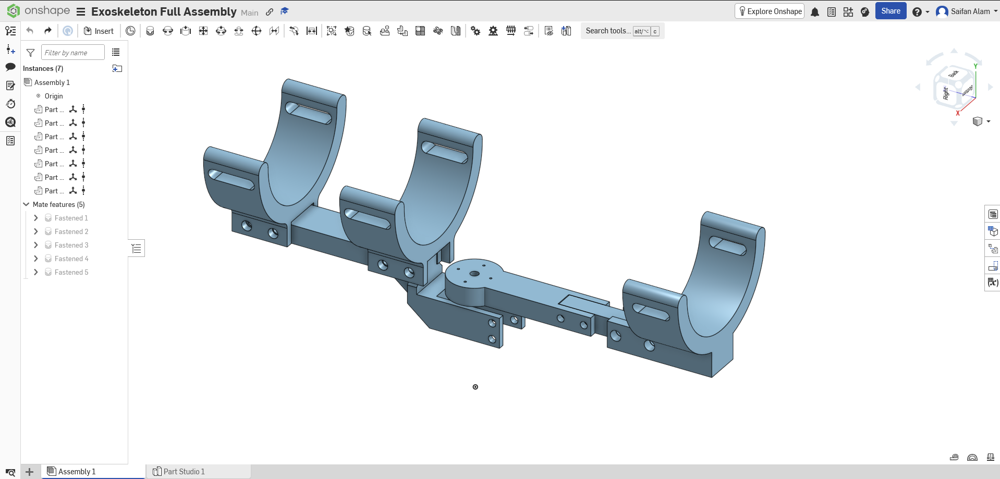
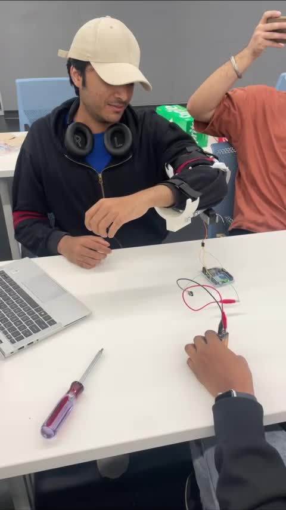

# TETRA Assistive Arm Exoskeleton — CAD Assembly & Servo Simulation

**Physical kit demonstration:** [Watch the 24-second video](demo/physical_exoskeleton_demo.mov)

## Overview

A CAD modeling and virtual assembly project based on the **TETRA TMU Exoskeleton Kit**. The project explores the mechanical layout of an assistive arm exoskeleton, including arm cuffs, structural links, a motor adapter, and an elbow-area connection. The supplied Arduino example demonstrates basic servo motion in simulation.

**Scope:** CAD modeling and virtual assembly, dimensional fit adjustments, and review of the kit's Wokwi servo-control demonstration. The CAD assembly is documented separately from the physical TETRA kit demonstration shown in the video. The video does not establish sensor-controlled assistance, independent hardware fabrication, or experimental performance validation.

## Tools

- **Onshape:** parametric CAD modeling and virtual assembly
- **STEP:** exchange format for the completed 3D assembly
- **Arduino Uno / C++:** example servo-control sketch from the kit
- **Wokwi:** Arduino and servo simulation

## Mechanical design and assembly

The CAD assembly includes:

- Two upper-arm cuffs and one lower-arm cuff
- Structural arm segments and mounting features
- Motor adapter and elbow-area connection
- Mounting holes and interfaces for joining components

The design was assembled in Onshape following the supplied TETRA TMU kit instructions. During assembly, a width mismatch was identified between a motor-adapter feature (approximately **0.686 in**) and its mating opening (initially **0.500 in**). The mating geometry was adjusted and the virtual assembly was visually checked from multiple views.

> The STEP file documents the current assembled geometry. Fit, clearances, interference, joint mobility, and load-bearing performance have not been independently validated here.

## CAD model

- [`CAD/Exoskeleton_Arm.step`](CAD/Exoskeleton_Arm.step) — exported full assembly
- [`images/full_assembly.png`](images/full_assembly.png) — completed Onshape assembly screenshot

Open the STEP file with a compatible CAD application to inspect the geometry.

## Physical kit demonstration

The [24-second demonstration video](demo/physical_exoskeleton_demo.mov) shows a person wearing the TETRA exoskeleton while the forearm section moves toward a bent-elbow position. The Arduino board and power connections are visible. This video documents the physical kit demonstration; it does not establish that force-sensor feedback controls the motion or that the CAD export was manufactured from this model.

**Publication note:** The recording shows identifiable participants. Confirm that everyone shown agrees to public posting before publishing this repository.

## Arduino servo simulation

The kit provides an Arduino Uno example using the `Servo.h` library. A servo connected to **digital pin 9** is commanded to sweep from **0° to 90° and back**, in **1° steps** with a **20 ms delay** per step.

- [Open the original TETRA Wokwi simulation](https://wokwi.com/projects/444032132243994625)
- [`Arduino/exoskeleton_servo.ino`](Arduino/exoskeleton_servo.ino) — documented copy of the kit's example behavior

**Important:** This demonstration does not read a force sensor or implement feedback-based arm assistance. It runs an automatic servo sweep. Do not wear or attach the mechanism to a person while testing this uncontrolled motion.

## Project highlights

- Built and assembled the multi-component exoskeleton model in Onshape
- Diagnosed and adjusted mating geometry to address a dimensional fit problem
- Documented the complete assembly and examined the supplied Arduino servo demonstration

## Credits

Mechanical assembly reference and servo demonstration are based on the **TETRA TMU Exoskeleton Kit Instructions**. The Wokwi project linked above is the supplied kit reference, not original firmware developed for this portfolio. CAD assembly work, fit adjustments, and repository documentation reflect the project work presented here.
